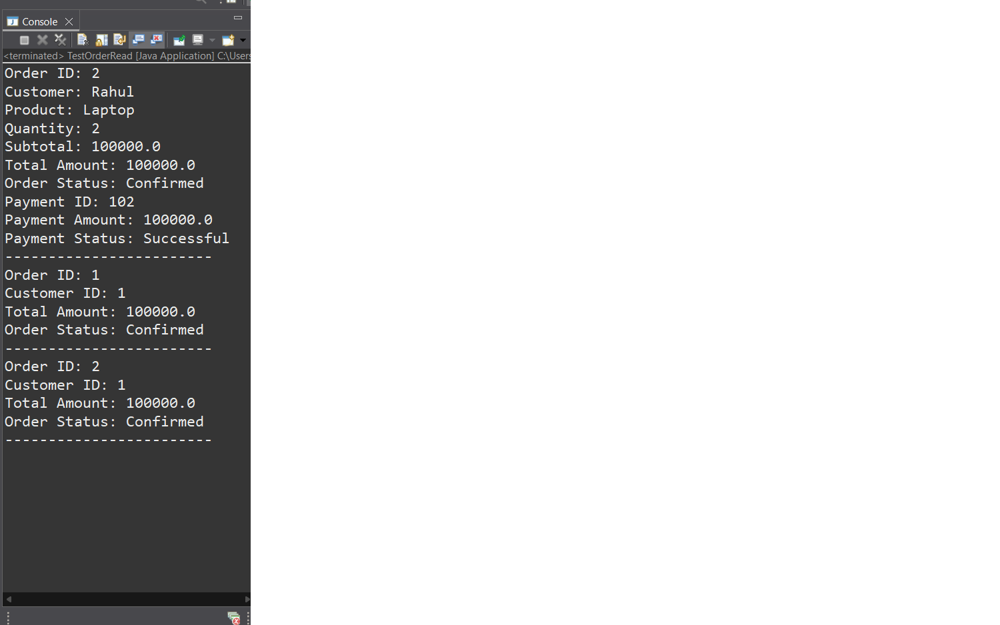
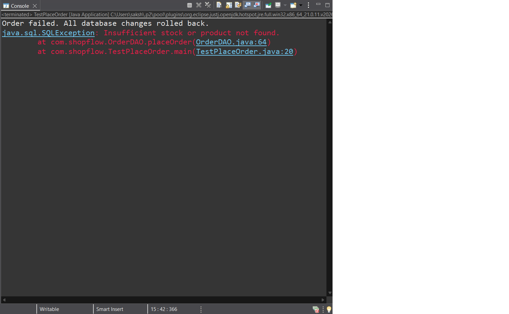

# ShopFlow – E-Commerce Order Management System

ShopFlow is a Java-based e-commerce order management system developed using Core Java, JDBC, and MySQL.

The project demonstrates how an e-commerce application manages customers, products, orders, order items, payments, and inventory.

## Technologies Used

- Java
- Core Java (OOP)
- JDBC
- MySQL
- SQL
- Eclipse IDE
- Git and GitHub

## Key Features

- Customer and product management
- Order creation with multiple products
- Automatic order total calculation
- Payment management
- Inventory and stock updates
- Database integration using JDBC
- Transaction management using commit and rollback
- Order details retrieval using SQL JOINs
- Display of all stored orders

## Database Tables

- customers
- products
- orders
- order_items
- payments

## Project Structure

src/
└── com.shopflow/
    ├── Customer.java
    ├── Product.java
    ├── Order.java
    ├── OrderItem.java
    ├── Payment.java
    ├── DBConnection.java
    ├── CustomerDAO.java
    ├── ProductDAO.java
    ├── OrderDAO.java
    ├── OrderItemDAO.java
    ├── PaymentDAO.java
    ├── OrderReadDAO.java
    └── AllOrdersDAO.java

## Transaction Management

ShopFlow uses JDBC transactions to ensure reliable order processing.

If an order cannot be completed due to insufficient stock or another database error, all related database changes are rolled back.

## How to Run

1. Install Java and MySQL.
2. Create the ShopFlow database and required tables.
3. Configure the database connection.
4. Add the MySQL JDBC driver to the project.
5. Configure the SHOPFLOW_DB_PASSWORD environment variable.
6. Run the application from Eclipse.

## Author

Developed as a Java portfolio project.

## Screenshots

### Order Details

### Successful Order Placement

### Transaction Rollback
